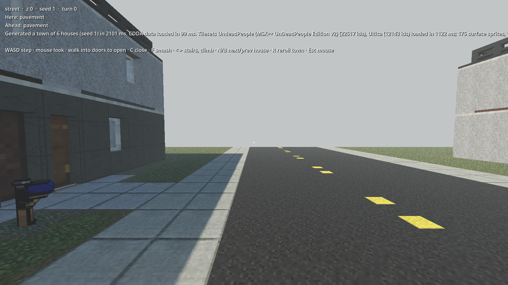
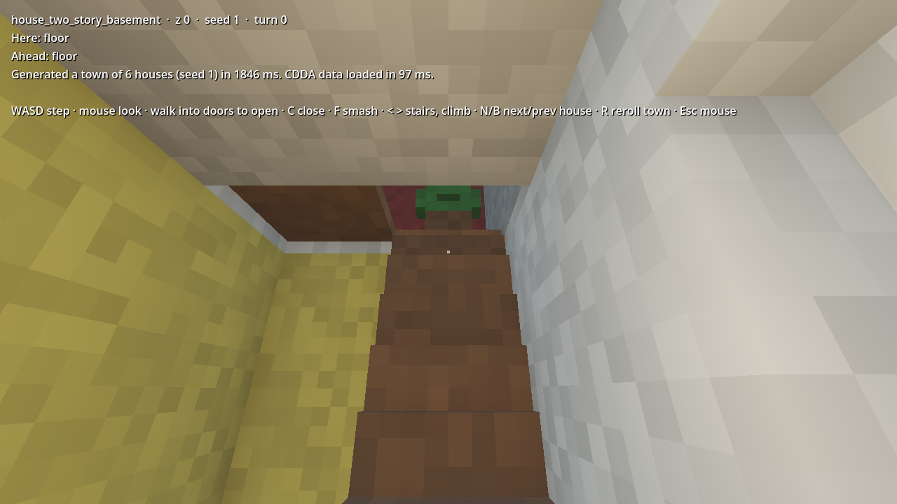
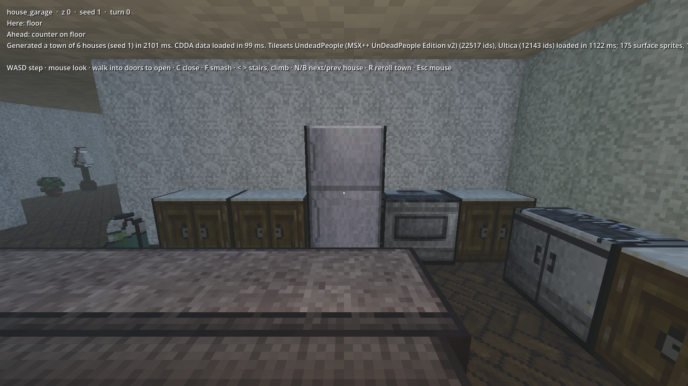
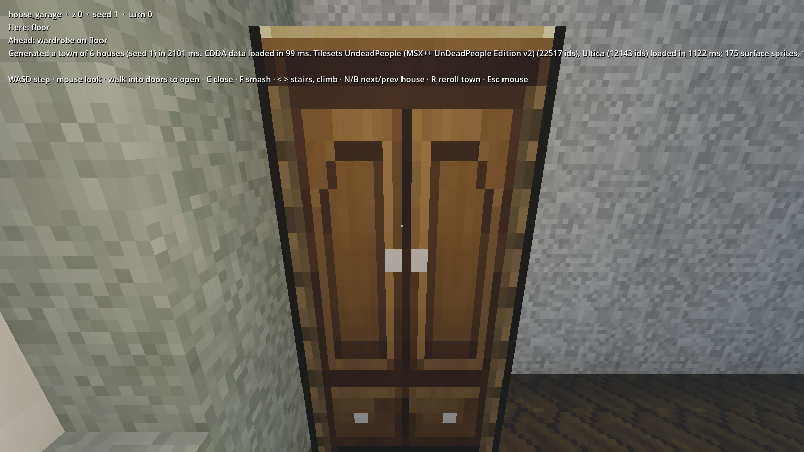

# cataclysm-3d

A first-person, turn-based, voxel 3D reimplementation of
[Cataclysm: Dark Days Ahead](https://github.com/CleverRaven/Cataclysm-DDA), built in Godot 4 (C#)
and driven by CDDA's own JSON content.

This is an unofficial fan project, not affiliated with CleverRaven. Game content and tilesets come
from CDDA under CC-BY-SA 3.0. See [CREDITS.md](CREDITS.md).

See [PLAN.md](PLAN.md) for the roadmap.

## Layout

| Path | What |
|---|---|
| `src/Sim` | Pure C# simulation core (no Godot types). Turns, map, creatures, rules. |
| `src/Importer` | Loads CDDA JSON and resolves `copy-from` / `extend` / `delete` / `relative` / `proportional`. Also reads tilesets (`Tiles/`): packed `tile_config.json` and unpacked per-sprite layouts, with fallback across tilesets and `looks_like`. |
| `game/` | Godot 4 .NET project: rendering, input, UI. References `Sim` and `Importer`. |
| `tests/` | xUnit tests for `Sim` and `Importer`. |
| `cdda-snapshot/` | Pinned CDDA data and tilesets, fetched by `tools/fetch-cdda-snapshot.ps1`. |
| `config/` | Project config (tileset priority, etc.). |
| `docs/` | Design notes and the list of deliberate divergences from CDDA. |

## Requirements

- .NET 8 SDK
- Godot 4 **.NET** edition (the `Godot.NET.Sdk` version in `game/Cataclysm3D.csproj` must match it)

## Getting started

```powershell
./tools/fetch-cdda-snapshot.ps1   # pull pinned CDDA data + tilesets into cdda-snapshot/
dotnet test                       # run the sim/importer tests
dotnet run --project tools/ImportCheck -c Release   # load + resolve all CDDA JSON, report gaps
```

Then open `game/project.godot` in Godot .NET and press Play.



The game starts on the street of a small town of six CDDA houses (M2). Each house is generated
on every z-level its CDDA `city_building` lists: basement on z-1, ground floor, upper floors and
the `_roof` mapgen on top. Walk in, take the stairs, or climb a downspout onto the roof.



### Tileset art (M3, first part)

Terrain and furniture are drawn from the
[UndeadPeople](https://github.com/Goodgulf-PL/UndeadPeopleTileset_Unpacked_New_Version) tileset,
with Ultica filling the gaps (`config/tilesets.json`; see [CREDITS.md](CREDITS.md)):

- Floors, roofs and ground show their sprite as their top surface, with CDDA's multitile pieces
  (carpet borders, grass edges). Walls repeat their sprite every meter.
- Furniture sprites are extruded into voxel models, one voxel per pixel: fridges and cupboards
  from their front, tables and beds from their top (with legs), chairs, toilets and lamps as
  standing silhouettes. Models are built once per sprite and cached.
- Ids with no sprite in either tileset keep the old placeholder shapes. Doors, windows and
  stairs keep their M1/M2 geometry; doors are painted from their sprite.




### Light and vision (M3)

The sim keeps CDDA's clock (1 turn = 1 second) and starts at 8:00 on spring day 1. The sun
crosses from east to west, warm and low at dawn and dusk; at night a dim moon lights the street,
and rooms are dark unless something lights them. Daylight comes into houses through windows
and doorways, so rooms are bright near windows and dark deep inside.

What you see is the sim's call, CDDA-style: shadowcasting from where you stand, then only the
tiles lit enough to make out (plus the tiles right next to you). Walls, closed doors, drawn
curtains, fridges and bookcases block sight; windows, open doors and low furniture don't.
Tiles you've seen but can't see now are drawn from memory, dim and grey; tiles you've never
seen are black. Carry a flashlight (L) to see in the dark. Terrain or furniture with CDDA's
`light_emitted` lights its surroundings (the starting town doesn't have any).

### Controls (M3)

| Key | Action |
|---|---|
| WASD | Step to one of the 8 neighboring tiles, relative to where you look |
| Mouse | Look (free, costs no time) |
| Walk into a door | Open it |
| C | Close the door you're facing |
| F | Smash what you're facing (windows break easily; locked doors take many kicks) |
| Walk onto stairs | Take them up or down (ladders too) |
| `<` / `>` (or `,` / `.`, PgUp / PgDn) | Go up / down the stairs or ladder you stand on, or climb a downspout or gutter drop next to you |
| L | Turn your flashlight on or off |
| 5 (or numpad 5) | Wait a turn (one second) |
| `\` / `\|` | Wait 30 minutes / wait until the next sunrise or sunset |
| N / B | Jump to the front of the next / previous house |
| R | Re-roll the whole town with a new seed (wall paint, flooring, variants) |
| Esc | Release / capture the mouse |

Face something you can use (a door, window, chair, stairs, a downspout) and a tooltip by the
crosshair lists the top three things you can do to it, with their keys: open, close, walk
through, climb, smash (with how hard that'll be).

While you're indoors, the levels above you are hidden nearby (each room keeps its ceiling), except
when you're near stairs going up.

Screenshot mode for checking visuals without playing:

```powershell
godot --path game -- --shot=out.png,12,28,0,4          # file, house-local tile x, y, yaw°, pitch°
godot --path game -- --shot=out.png,3,8,-90,-25,1,0    # ...then z-level and house (lot) index
```

Add `--time=HH:MM` (or `--time=day,HH:MM`, days from 0) to set the clock and `--flashlight` to
have it on, e.g. `godot --path game -- --time=23:30 --flashlight --shot=night.png,@f_fridge,3,0,-12`.
Shots in one run share what you've seen, so later shots show remembered tiles.

House-local coordinates are the mapgen rows as drawn in the JSON, even for houses turned to face
the road; yaw is in the world (0 = north). Lots 0–2 are south of the road, 3–5 north of it.

```powershell
godot --path game -- --shot=out.png,@f_fridge,3,0,-12  # stand 3 tiles south of the first fridge in town
godot --headless --path game -- --art-report            # which sprite each id in the town is drawn from
```

Mapgen debugging: `dotnet run --project tools/ImportCheck -c Release -- --print bungalow01_1 3`
prints a generated house as ASCII, and `-- --town 1` prints every z-level of the game's town.
