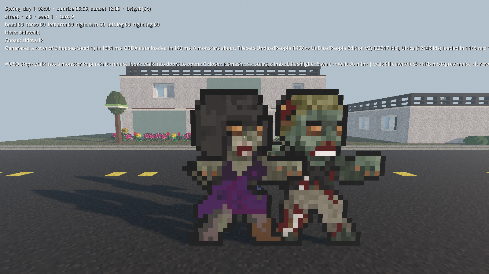
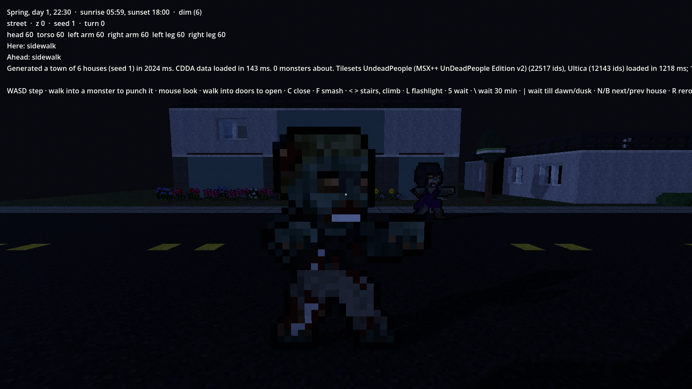
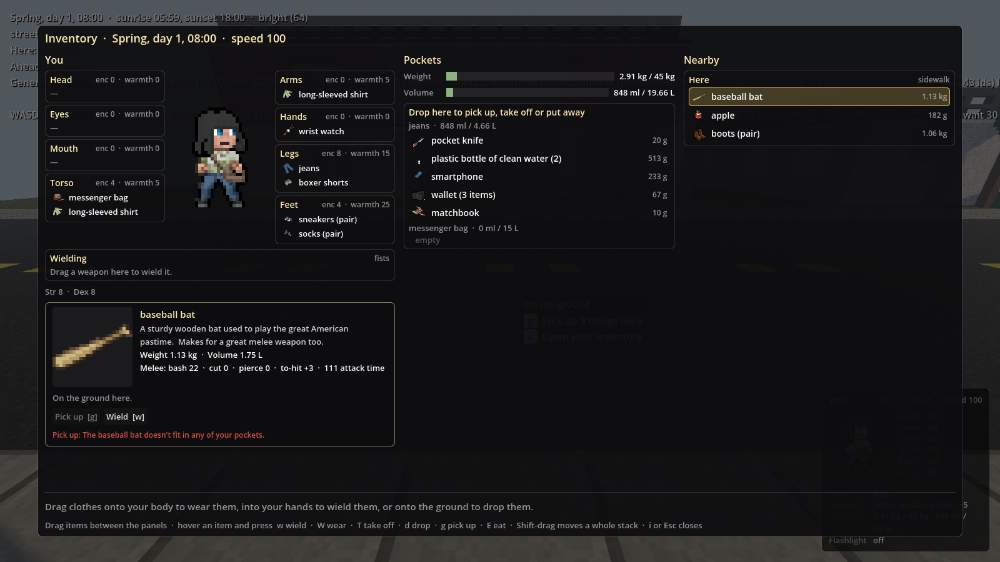
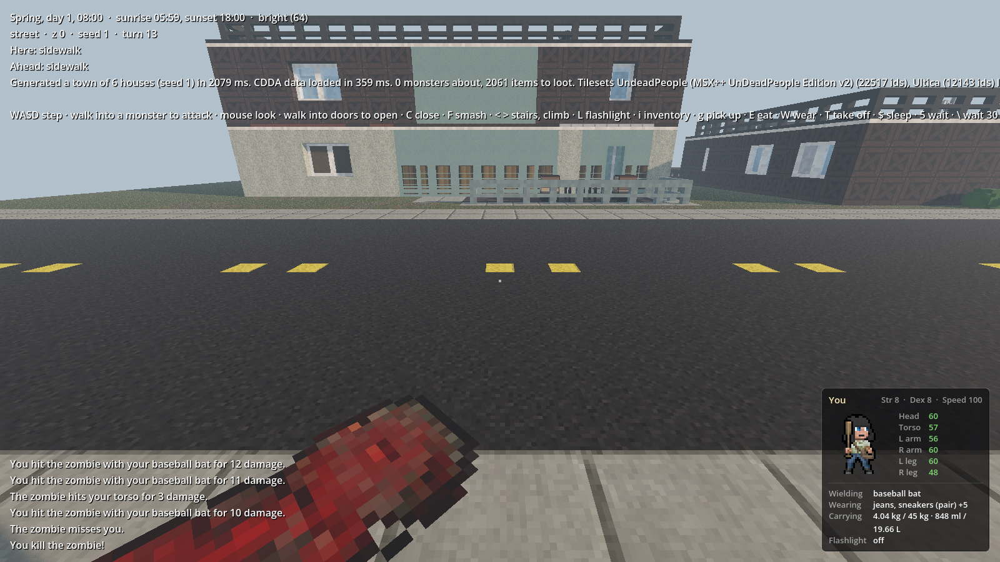

# cataclysm-3d

A first-person, turn-based, voxel 3D reimplementation of
[Cataclysm: Dark Days Ahead](https://github.com/CleverRaven/Cataclysm-DDA), built in Godot 4 (C#)
and driven by CDDA's own JSON content.

This is an unofficial fan project, not affiliated with CleverRaven. Game content and tilesets come
from CDDA under CC-BY-SA 3.0. See [CREDITS.md](CREDITS.md).

See [PLAN.md](PLAN.md) for the roadmap.

## Layout

| Path | What |
|---|---|
| `src/Sim` | Pure C# simulation core (no Godot types). Turns, map, creatures, rules. |
| `src/Importer` | Loads CDDA JSON and resolves `copy-from` / `extend` / `delete` / `relative` / `proportional`. Also reads tilesets (`Tiles/`): packed `tile_config.json` and unpacked per-sprite layouts, with fallback across tilesets and `looks_like`. |
| `game/` | Godot 4 .NET project: rendering, input, UI. References `Sim` and `Importer`. |
| `tests/` | xUnit tests for `Sim` and `Importer`. |
| `cdda-snapshot/` | Pinned CDDA data and tilesets, fetched by `tools/fetch-cdda-snapshot.ps1`. |
| `config/` | Project config (tileset priority, etc.). |
| `docs/` | Design notes and the list of deliberate divergences from CDDA. |

## Requirements

- .NET 8 SDK
- Godot 4 **.NET** edition (the `Godot.NET.Sdk` version in `game/Cataclysm3D.csproj` must match it)

## Getting started

```powershell
./tools/fetch-cdda-snapshot.ps1   # pull pinned CDDA data + tilesets into cdda-snapshot/
dotnet test                       # run the sim/importer tests
dotnet run --project tools/ImportCheck -c Release   # load + resolve all CDDA JSON, report gaps
```

Then open `game/project.godot` in Godot .NET and press Play.


The game starts on the street of a small town of six CDDA houses (M2). Each house is generated
on every z-level its CDDA `city_building` lists: basement on z-1, ground floor, upper floors and
the `_roof` mapgen on top. Walk in, take the stairs, or climb a downspout onto the roof.


### Tileset art (M3, first part)

Terrain and furniture are drawn from the
[UndeadPeople](https://github.com/Goodgulf-PL/UndeadPeopleTileset_Unpacked_New_Version) tileset,
with Ultica filling the gaps (`config/tilesets.json`; see [CREDITS.md](CREDITS.md)):

- Floors, roofs and ground show their sprite as their top surface, with CDDA's multitile pieces
  (carpet borders, grass edges). Walls repeat their sprite every meter.
- Furniture sprites are extruded into voxel models, one voxel per pixel: fridges and cupboards
  from their front, tables and beds from their top (with legs), chairs, toilets and lamps as
  standing silhouettes. Models are built once per sprite and cached.
- Ids with no sprite in either tileset keep the old placeholder shapes. Doors, windows and
  stairs keep their M1/M2 geometry; doors are painted from their sprite.


### Light and vision (M3)

The sim keeps CDDA's clock (1 turn = 1 second) and starts at 8:00 on spring day 1. The sun
crosses from east to west, warm and low at dawn and dusk; at night a dim moon lights the street,
and rooms are dark unless something lights them. Daylight comes into houses through windows
and doorways, so rooms are bright near windows and dark deep inside.

What you see is the sim's call, CDDA-style: shadowcasting from where you stand, then only the
tiles lit enough to make out (plus the tiles right next to you). Walls, closed doors, drawn
curtains, fridges and bookcases block sight; windows, open doors and low furniture don't.
Tiles you've seen but can't see now are drawn from memory, dim and grey; tiles you've never
seen are black. Carry a flashlight (L) to see in the dark. Terrain or furniture with CDDA's
`light_emitted` lights its surroundings (the starting town doesn't have any).

### Zombies (M4)

The town has zombies now, from CDDA's own monster JSON: a few from `GROUP_ZOMBIE` out on the
street, and whatever the houses' mapgen places (`place_monsters`). They're drawn as billboards of
their tileset sprites. They stand around and wander until they see you, then come for you. By day
they see you from 40 tiles; at night only from a few, unless your flashlight gives you away.
They walk around walls and through open doors, smash windows to get in, and need help to break
down a door. Next to you, they claw at you.

Walk into a zombie to punch it. A panel in the bottom-right corner shows you as CDDA draws you
(the tileset's body with a sprite for each thing you wear, starting in the Unemployed
profession's clothes, and a random CDDA hair style), your hit points per body part colored by health, your stats and your
gear; the message log sits in the bottom-left. You die when your head or torso reaches 0, and Enter
starts a new run. Waiting stops when a zombie comes into view or hurts you. See [docs/divergences.md](docs/divergences.md) for how the
rules differ from CDDA.




### Items and survival (M5)

The houses hold CDDA's own loot, rolled from its item groups the way its mapgen places them:
clothes in dressers, food in fridges and cupboards, dishes, tools, books. Items come from CDDA's
item JSON (about 2,000 to 2,500 in the town) and stand on the floor, tables and beds as small
billboards of their tileset sprites; what's shut away in a fridge or dresser isn't drawn, but
it's there when you stand next to it. You start with the Unemployed profession's whole kit: its
clothes on, and a pocket knife, a bottle of water, a phone, a wallet and matches in your pockets.



Press `i` for the inventory, a modal over the 3D view (mouse-look pauses while it's open). On the
left is your portrait with a slot per body part showing what you wear there, with its encumbrance
and warmth, and your hands; in the middle, your pockets, by the garment or bag they're in, with
how much weight and space you have left; on the right, what lies on your tile and the eight
around it. **Drag** an item from one place to another: onto your body to wear it, into your hands
to wield it, into your pockets to pick it up or take it off, onto a tile to drop it. While you
drag, the places that would take it turn green and the rest red; hovering a red one says why
("Can't wear more than one rigid item on your left foot!", "The t-shirt doesn't go on your
feet", "There's no room for the pillow"). Shift-drag moves a whole stack. Hover an item for its
details (weight, volume, coverage, encumbrance, warmth, protection, melee damage, calories), or
click it to select it: it lights up, and a panel under your portrait shows its sprite large,
all its details, and a button for each thing you can do with it (with the reason under any that
are greyed out). CDDA's keys work on the item under the mouse, or on the selected one. Everything costs CDDA's moves, so the world goes on while you rummage.

What you wear protects you (each piece stops a blow with its coverage chance, by its materials),
what you wield is what you hit with (a baseball bat hits three to four times as hard as a fist), and your
pockets and bags limit what you can carry: a naked survivor carries nothing, and a 90 cm bat
won't go in a backpack, so you hold it. Hunger, thirst and sleepiness tick with the clock, as in
CDDA 0.I, and show under your portrait: drink and eat (`E`) to keep them down, and sleep (`$`) in
a bed or on the floor, which passes the hours until you're rested or something comes for you.



### Controls (M5)

| Key | Action |
|---|---|
| WASD | Step to one of the 8 neighboring tiles, relative to where you look; walk into a monster to attack it |
| Mouse | Look (free, costs no time) |
| Walk into a door | Open it |
| C | Close the door you're facing |
| F | Smash what you're facing (windows break easily; locked doors take many kicks), or punch the monster there |
| Walk onto stairs | Take them up or down (ladders too) |
| `<` / `>` (or `,` / `.`, PgUp / PgDn) | Go up / down the stairs or ladder you stand on, or climb a downspout or gutter drop next to you |
| L | Turn your flashlight on or off |
| i | Inventory: drag items to wear, wield, take off, pick up and drop them |
| g | Pick up everything on your tile (with nothing here, opens the inventory to reach the tiles around you) |
| E | Eat or drink: opens the inventory asking what |
| W (Shift+w) / T | Wear / take off: opens the inventory asking what |
| $ | Sleep (in a bed, on a sofa, or on the floor); time passes until you're rested or woken |
| In the inventory | Click an item to select it and see its details and actions. On the item under the mouse (or the selected one): `w` wield, `W` wear, `T` take off, `d` drop, `g` pick up, `E` eat. `i` or Esc closes it |
| 5 (or numpad 5) | Wait a turn (one second) |
| `\` / `\|` | Wait 30 minutes / wait until the next sunrise or sunset (a zombie showing up stops it) |
| Enter | After you die: start a new run |
| N / B | Jump to the front of the next / previous house |
| R | Re-roll the whole town with a new seed (wall paint, flooring, variants) |
| Esc | Release / capture the mouse (or close the inventory) |

Face something you can use (a door, window, chair, stairs, a downspout) and a tooltip by the
crosshair lists the top three things you can do to it, with their keys: open, close, walk
through, climb, smash (with how hard that'll be).

While you're indoors, the levels above you are hidden nearby (each room keeps its ceiling), except
when you're near stairs going up.

Screenshot mode for checking visuals without playing:

```powershell
godot --path game -- --shot=out.png,12,28,0,4          # file, house-local tile x, y, yaw°, pitch°
godot --path game -- --shot=out.png,3,8,-90,-25,1,0    # ...then z-level and house (lot) index
```

Add `--time=HH:MM` (or `--time=day,HH:MM`, days from 0) to set the clock and `--flashlight` to
have it on, e.g. `godot --path game -- --time=23:30 --flashlight --shot=night.png,@f_fridge,3,0,-12`.
Shots in one run share what you've seen, so later shots show remembered tiles.

`--female` plays a woman (the female body sprite and clothes). Monsters: `--no-zombies` leaves the town empty, `--zombie=dx,dy[,id]` puts a monster (default
`mon_zombie`) dx tiles east and dy south of the first shot, `--wait=N` waits N turns before each
shot so they can close in, and `--fight` then punches whatever is next to you until one of you
dies, e.g. `godot --path game -- --no-zombies --zombie=0,-4 --wait=6 --fight --shot=fight.png,12,-1,0,-20`.

Items: `--give=id,id` puts CDDA items on the ground where the first shot stands, `--wear=id,id`
and `--wield=id` put them on you, and `--inventory` opens the inventory for every shot (`--select=id` opens it with that item selected), e.g.
`godot --path game -- --no-zombies --wield=bat --wear=jacket_light --give=apple,boots --inventory --shot=inv.png,12,-1,0,-20`.
`@loot` as a shot's target stands you next to the first pile of loot you can see.

House-local coordinates are the mapgen rows as drawn in the JSON, even for houses turned to face
the road; yaw is in the world (0 = north). Lots 0–2 are south of the road, 3–5 north of it.

```powershell
godot --path game -- --shot=out.png,@f_fridge,3,0,-12  # stand 3 tiles south of the first fridge in town
godot --headless --path game -- --art-report            # which sprite each id in the town is drawn from
```

Mapgen debugging: `dotnet run --project tools/ImportCheck -c Release -- --print bungalow01_1 3`
prints a generated house as ASCII, `-- --town 1` prints every z-level of the game's town, and
`-- --loot 1` counts the loot each house spawns.
