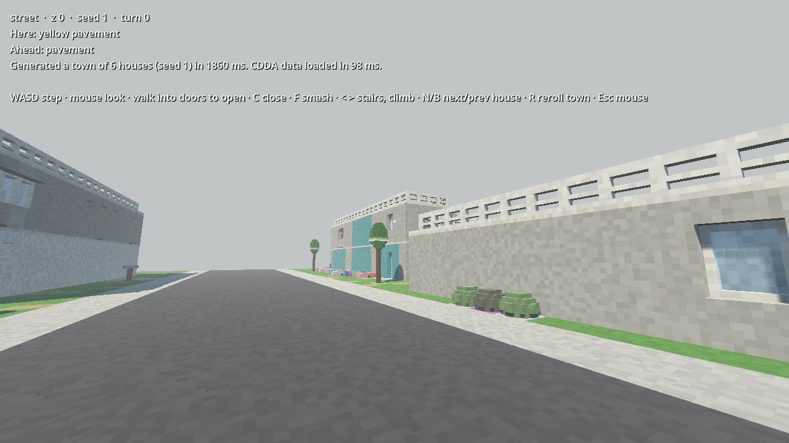

# cataclysm-3d

A first-person, turn-based, voxel 3D reimplementation of
[Cataclysm: Dark Days Ahead](https://github.com/CleverRaven/Cataclysm-DDA), built in Godot 4 (C#)
and driven by CDDA's own JSON content.

This is an unofficial fan project, not affiliated with CleverRaven. Game content and tilesets come
from CDDA under CC-BY-SA 3.0. See [CREDITS.md](CREDITS.md).

See [PLAN.md](PLAN.md) for the roadmap.

## Layout

| Path | What |
|---|---|
| `src/Sim` | Pure C# simulation core (no Godot types). Turns, map, creatures, rules. |
| `src/Importer` | Loads CDDA JSON and resolves `copy-from` / `extend` / `delete` / `relative` / `proportional`. |
| `game/` | Godot 4 .NET project: rendering, input, UI. References `Sim` and `Importer`. |
| `tests/` | xUnit tests for `Sim` and `Importer`. |
| `cdda-snapshot/` | Pinned CDDA data and tilesets, fetched by `tools/fetch-cdda-snapshot.ps1`. |
| `config/` | Project config (tileset priority, etc.). |
| `docs/` | Design notes and the list of deliberate divergences from CDDA. |

## Requirements

- .NET 8 SDK
- Godot 4 **.NET** edition (the `Godot.NET.Sdk` version in `game/Cataclysm3D.csproj` must match it)

## Getting started

```powershell
./tools/fetch-cdda-snapshot.ps1   # pull pinned CDDA data + tilesets into cdda-snapshot/
dotnet test                       # run the sim/importer tests
dotnet run --project tools/ImportCheck -c Release   # load + resolve all CDDA JSON, report gaps
```

Then open `game/project.godot` in Godot .NET and press Play.



The game starts on the street of a small town of six CDDA houses (M2). Each house is generated
on every z-level its CDDA `city_building` lists: basement on z-1, ground floor, upper floors and
the `_roof` mapgen on top. Walk in, take the stairs, or climb a downspout onto the roof.


### Controls (M2)

| Key | Action |
|---|---|
| WASD | Step to one of the 8 neighboring tiles, relative to where you look |
| Mouse | Look (free, costs no time) |
| Walk into a door | Open it |
| C | Close the door you're facing |
| F | Smash what you're facing (windows break easily; locked doors take many kicks) |
| Walk onto stairs | Take them up or down (ladders too) |
| `<` / `>` (or `,` / `.`, PgUp / PgDn) | Go up / down the stairs or ladder you stand on, or climb a downspout or gutter drop next to you |
| N / B | Jump to the front of the next / previous house |
| R | Re-roll the whole town with a new seed (wall paint, flooring, variants) |
| Esc | Release / capture the mouse |

While you're indoors, the levels above you are hidden nearby (each room keeps its ceiling), except
when you're near stairs going up.

Screenshot mode for checking visuals without playing:

```powershell
godot --path game -- --shot=out.png,12,28,0,4          # file, house-local tile x, y, yaw°, pitch°
godot --path game -- --shot=out.png,3,8,-90,-25,1,0    # ...then z-level and house (lot) index
```

House-local coordinates are the mapgen rows as drawn in the JSON, even for houses turned to face
the road; yaw is in the world (0 = north). Lots 0–2 are south of the road, 3–5 north of it.

Mapgen debugging: `dotnet run --project tools/ImportCheck -c Release -- --print bungalow01_1 3`
prints a generated house as ASCII, and `-- --town 1` prints every z-level of the game's town.
